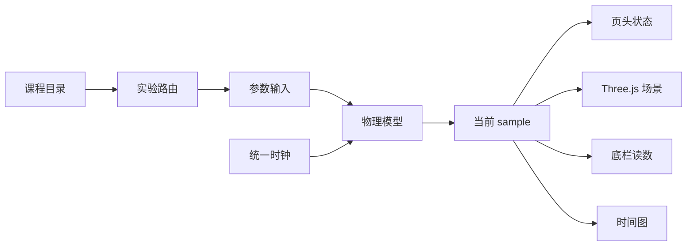

# Physics Lab：面向 AP 物理学习的交互式可视化实验平台设计与实现

**作者：** Bruce  
**项目类型：** Web 物理实验与课程作品  
**技术栈：** Next.js、React、TypeScript、Three.js  
**日期：** 2026-10-14

## 摘要

Physics Lab 是一个按 AP Physics 1、AP Physics 2、AP Physics C: Mechanics 和 AP Physics C: Electricity and Magnetism 组织的交互式物理实验网站。项目把物理模型、三维场景、参数控制、公式代入、实时读数和时间序列图整合到同一个实验台中，使学生能够通过改变质量、速度、角度、摩擦系数、电路参数等条件，观察模型状态如何变化。

项目当前包含 40 个可进入的独立实验条目。基础实验可在不同课程之间复用，但目录按照各课程自己的单元和权重呈现。系统使用 TypeScript 实现闭式解、状态机与数值积分，使用 React 管理交互状态，使用 React Three Fiber 和 Three.js 显示装置、轨迹和受力关系。本轮结课修订重点解决了竖直圆周绳松弛、动态圆锥摆、孔流可见性、受力标注、时间图范围与窄屏布局等问题。

本文从项目背景、目标、系统架构、物理建模、交互设计和验证方法出发，总结 Physics Lab 的设计思路与实现过程，并说明模型边界和后续可以扩展的方向。

**关键词：** 物理教育；交互式仿真；AP Physics；Three.js；数值积分；科学可视化

## 1. 项目背景

物理公式通常以符号关系出现，但学习困难往往发生在公式与具体过程之间。例如，学生可以记住 `T = mv²/R + mg cosφ`，却不一定会立即意识到绳子只能提供拉力，不能提供负张力。当公式计算得到 `T < 0` 时，正确结论不是小球继续贴着圆周运动，而是约束失效，模型必须切换为抛体运动。

传统静态示意图还存在另一个限制：它只能展示一组条件。摩擦、碰撞、圆周运动、RC 电路或透镜成像的行为都依赖参数。若学生不能改变参数，就很难观察临界条件、边界状态和不同模型之间的联系。

Physics Lab 因此选择把每个实验设计成一个可操作的“模型窗口”。学生看到的不只是动画，还包括当前参数、公式、数值、状态说明和图线。网站的任务不是替代真实实验，而是帮助学生在进入真实测量前建立可检查的预测，并在课后重新观察课堂中讨论过的边界情况。

## 2. 项目目标

项目有五个主要目标。

### 2.1 将课程结构转化为可浏览的实验目录

首页不是按开发顺序罗列组件，而是按四门 AP 物理课程及其单元组织内容。这样可以回答两个问题：这个实验属于哪一部分课程，以及它与同一单元中的其他实验有什么联系。

### 2.2 让公式、画面与读数保持一致

实验台的场景、页头、底栏、公式区和图表必须描述同一个时刻。显示层不能单独猜测状态，也不能使用与模型不同的近似。所有学生可见计算结果统一保留两位小数，内部积分仍保持浮点全精度。

### 2.3 展示边界条件，而不只展示理想成功状态

网站需要处理静摩擦与滑动摩擦切换、物体离开轨道、绳张力归零、行程到达上限等状态。参数改变后，模型应给出新的物理结果，而不是保持一段预先录制的动画。

### 2.4 用视觉层级支持受力分析

受力箭头、分力虚线、轨迹、装置和数值标签应有明确层级。标签不能覆盖研究对象，目录缩略图也不应把完整力图压缩到很小的画布中。

### 2.5 支持桌面展示和移动端查看

桌面端适合同时显示参数、场景和图表；移动端空间不足，必须优先显示实验场景，再显示参数和图表。课程概览也要从三列表格转为单元卡片，避免中英文名称相互挤压。

## 3. 需求分析

2026-10-14 的作品检查记录了五类问题。

1. 竖直圆周在张力为负时仍沿圆运动，场景与读数矛盾。
2. 孔流公式正确，但水箱、水位和水舌几乎看不见。
3. 斜面、圆周和阿特伍德机的受力数字压在物体上，目录预览信息过密。
4. 约 400 px 宽度下，课程表中英文叠在一起，三维画布需要滚动后才能看到。
5. 时间图强制包含 0，正值曲线贴近上沿；长时间播放后全部历史被压缩到固定宽度中。

检查还指出圆锥摆只在初始平衡速度下成立。改变切向速度后，张角仍保持固定，画面没有实现状态说明中所说的升降。这不是单纯的文字问题，而是模型缺少 spherical pendulum 动力学。

原始审查和修复前截图保存在 [2026-10-14 作品检查](reviews/2026-10-14-physics-lab-site-review.md)。

## 4. 系统架构

Physics Lab 使用 Next.js App Router。页面和课程说明默认由 Server Component 渲染；需要状态、动画帧或浏览器 API 的实验台使用 Client Component。Three.js 画布通过动态导入在客户端加载，避免服务端渲染访问 WebGL。

系统可以分为四层：

1. **课程与路由层**：`app/` 和 `lib/experiments/` 定义页面、课程、单元、实验 slug 与预览类型。
2. **物理模型层**：`lib/models/` 提供闭式解、状态机、RK4 积分、格式化和单元测试。
3. **实验台层**：`components/*-lab.tsx` 组合参数、状态、公式、场景、读数和图表。
4. **可视化层**：`components/*-scene.tsx` 与 `components/lab-3d.tsx` 把 sample 转换为装置、轨迹、箭头和标签。

这种分层的核心意义是让显示组件只消费模型结果。场景不重新计算另一套速度，公式区也不维护另一份状态。模型修改后，所有显示位置通过同一个 sample 更新。

## 5. 物理模型设计

### 5.1 闭式解与数值积分的选择

可以直接求解的模型优先使用闭式解。例如，匀变速直线、理想抛体、托里拆利孔流、RC 充放电和薄透镜公式都可以在任意时刻直接计算。闭式解便于测试，也不会积累时间步误差。

需要处理耦合变量或约束事件时使用数值积分。例如，圆锥摆的极角与方位角相互影响，竖直圆周还需要在张力归零时切换方程。项目对这类模型使用固定步长 RK4，并为关键守恒量或事件写回归测试。

### 5.2 竖直圆周的绳约束状态机

绳拉紧时，小球满足

$$
\ddot{\varphi}=-\frac{g}{R}\sin\varphi
$$

绳张力为

$$
T=m\left(\frac{v^2}{R}+g\cos\varphi\right)
$$

模型从底端初值开始积分，并检查张力是否从正值降到 0。若发生事件，系统记录脱轨时刻 $t_d$、位置 $(x_d,y_d)$ 和速度 $(v_{x,d},v_{y,d})$。之后使用

$$
x=x_d+v_{x,d}(t-t_d)
$$

$$
y=y_d+v_{y,d}(t-t_d)-\frac12g(t-t_d)^2
$$

计算抛体阶段。此时张力显示为 0，场景不再画绳，也不再用 `mv²/R` 解释抛体运动。

这个状态机区分三种结果：

- 速度较低，绳始终拉紧，小球往返摆动。
- 中间速度，绳在上升过程中松弛，小球脱轨。
- $v_0\ge\sqrt{5gR}$，小球保持约束并完成过顶。

### 5.3 动态圆锥摆

圆锥摆原模型把张角固定为滑条值，只改变方位角。该做法只在切向速度恰好等于平衡速度时成立。本轮把张角和速度改为初始条件，并使用 spherical pendulum 方程：

$$
\ddot{\theta}=\sin\theta\cos\theta\,\dot{\phi}^2-\frac{g}{L}\sin\theta
$$

$$
\ddot{\phi}=-2\cot\theta\,\dot{\theta}\dot{\phi}
$$

当初始速度等于平衡速度时，$\dot{\theta}=0$，张角保持不变。当速度偏高或偏低时，$\theta(t)$ 会变化，摆球出现升降与章动。动态张力为

$$
T=mL\left(\dot{\theta}^2+\sin^2\theta\,\dot{\phi}^2\right)+mg\cos\theta
$$

测试分别检查平衡解、非平衡运动方向、总机械能和绕竖直轴角动量。这些测试不是证明数值解绝对精确，而是限制积分误差并防止后续重构破坏主要物理关系。

### 5.4 流体孔流

孔流模型使用

$$
v=\sqrt{2g(H-y_h)}
$$

以及

$$
t_f=\sqrt{\frac{2y_h}{g}},\qquad R=vt_f
$$

计算出流速度、飞行时间和射程。审查确认数值正确，因此本轮没有修改公式，只修改水箱、水位、孔口、水舌和落点的显示。这个决定体现了“先判断模型还是显示出错”的调试原则。

## 6. 交互与视觉设计

### 6.1 仪器式实验台

桌面端采用参数、场景、图表三栏布局。场景位于中心并占最大宽度，参数与公式位于左侧，时间图位于右侧。页头集中显示当前时间、关键量和模型状态，底栏保留与场景直接相关的读数。

界面使用海军蓝表示主要结构与力，金色表示第二数据系列或射程，冷灰表示背景与辅助网格。设计不使用装饰性霓虹、复杂渐变或持续动画，因为这些效果会与物理运动争夺注意力。

### 6.2 受力标签

共享 `VectorArrow` 根据箭头方向计算箭头尖端，再应用场景提供的外置偏移。箭头尖端与标签之间画短引线。斜面、圆周和阿特伍德场景可以分别安排 `mg`、`N`、`T`、`f_s` 或 `f_k` 的位置。

目录缩略图处于预览模式时，完整受力层被隐藏，只保留装置与运动。进入实验台后，受力箭头和两位小数读数才完整出现。这样既保留目录的辨识度，也避免在小画布上堆积信息。

### 6.3 时间图

旧图表把 0 强制加入纵轴范围。新图表只根据可见数据计算范围，并在最小值和最大值两端加入 padding。常量正加速度会围绕该常量显示，而不是贴在图顶端。

横轴采用滑动窗口。一般实验显示最近 10 秒，周期运动显示最近约 3 个周期。窗口边界保留前一个采样点，使折线从左边界连续进入。当前 marker、页头、场景和底栏读取同一时刻的模型 sample。

### 6.4 响应式策略

小于 640 px 时，课程考纲从三列表格变为单元块。中文标题、英文名称和占比各有独立空间。

小于 768 px 时，实验台顺序变为场景、参数、图表。三维画布使用响应式最小高度，避免在矮屏或窄屏中塌缩。桌面三栏与 1280×720 的单屏 cockpit 保持原结构。

## 7. 工程实现与质量控制

### 7.1 测试先行

本轮先在 `circular-motion.test.ts` 中写出竖直脱轨和动态圆锥摆的预期，再实现模型。图表范围和标签布局也被抽成纯函数，并分别建立测试文件。纯函数测试不依赖 WebGL，可以快速检查边界输入。

### 7.2 分层验证

项目使用三层验证：

1. `npm test` 检查模型、目录与预览预算。
2. `npm run lint` 检查 React Hooks、可访问性与代码问题。
3. `npm run build` 检查 Next.js production 编译、类型与路由生成。

浏览器验收覆盖 375×667、400×900、768×1024 和 1440×900。重点路由包括竖直圆周、圆锥摆、流体孔流、斜面摩擦、阿特伍德机和匀变速直线运动。

### 7.3 可追溯材料

项目在 `evidence/` 中保存阶段学习记录，在 `docs/superpowers/specs/` 中保存设计规格，在 `docs/reviews/` 中保存外部检查和修复前截图。代码、测试、设计决定与审查证据可以相互对应。

## 8. 结果

本轮修订把原来由负张力暴露出的模型矛盾改成了明确的约束切换；把圆锥摆从固定角运动学演示扩展为非平衡动力学；把数值正确但不可见的孔流场景重新表达；把受力标签、目录预览、时间图和移动布局统一到共享规则中。

2026-10-14 的最终验收结果如下：

- `npm test`：217 项测试通过，0 项失败。
- `npm run lint`：ESLint 通过。
- `npm run build`：Next.js production build、TypeScript 检查与 40 个实验路径的静态生成通过。
- 浏览器检查：覆盖 375×667、400×900、768×1024 与 1440×900，并逐页检查首页、关于页、竖直圆周、圆锥摆、孔流、斜面摩擦、阿特伍德机与匀变速直线运动。
- 行为检查：竖直圆周在 0.36 s 发生张力归零并进入抛体阶段；非平衡圆锥摆的张角由初始 25.00° 动态变化；直线运动图在 15 s 显示 5–15 s 窗口，并在 60 s 自动暂停。

项目不使用虚构的性能百分比或学习效果数字，因为当前工作没有进行受控用户研究。

## 9. 限制与未来工作

Physics Lab 仍有以下限制。

1. 数值积分使用固定步长。它适合当前参数范围，但不是通用高精度求解器。
2. 三维场景用于解释模型，不模拟空气、水体表面、材料弹性或传感器噪声。
3. 目前缺少完整的浏览器截图回归测试，视觉验收仍需要人工检查。
4. 目录中的部分实验包含多个模式，但不是每种真实实验误差都被建模。
5. 课程覆盖仍有缺口，例如二维碰撞、独立的功率实验和管道连续方程装置。
6. 项目尚未进行正式课堂对照研究，因此不能从网站功能直接推导学习成效。

后续可以优先增加二维碰撞、测量不确定度、实验数据导出与教师任务单。若继续扩大模型数量，还可以为各实验建立统一的初始条件、事件和守恒量接口，减少实验台之间的重复代码。

## 10. 结论

Physics Lab 的核心不是“把公式做成动画”，而是建立一条可检查的数据链：参数进入模型，模型产生当前状态，场景、公式、读数和图表共同解释这个状态。当约束失效时，方程和画面一起切换；当参数改变时，系统重新计算，而不是继续播放固定结果。

本项目把课程目录、物理建模、科学可视化、响应式界面和软件测试结合在同一个作品中。结课修订进一步说明，物理可视化的质量不仅取决于画面是否美观，还取决于边界条件是否真实、数值是否一致，以及学生能否从界面中读出正确的物理关系。
