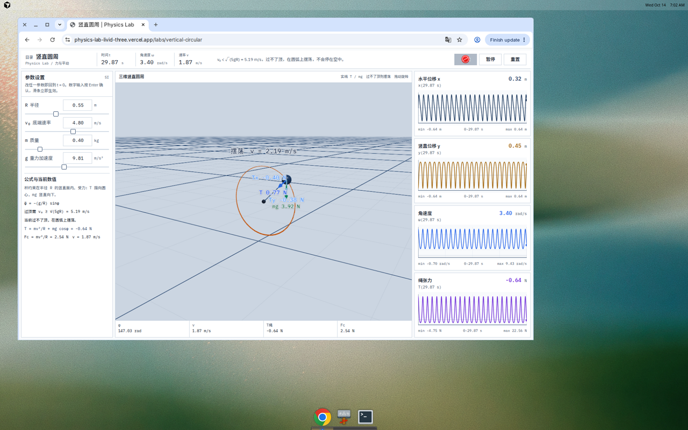
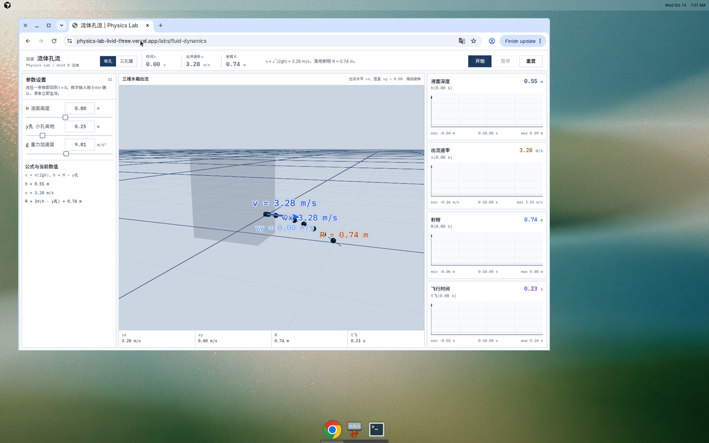
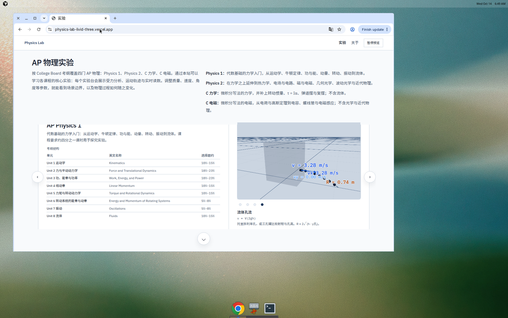
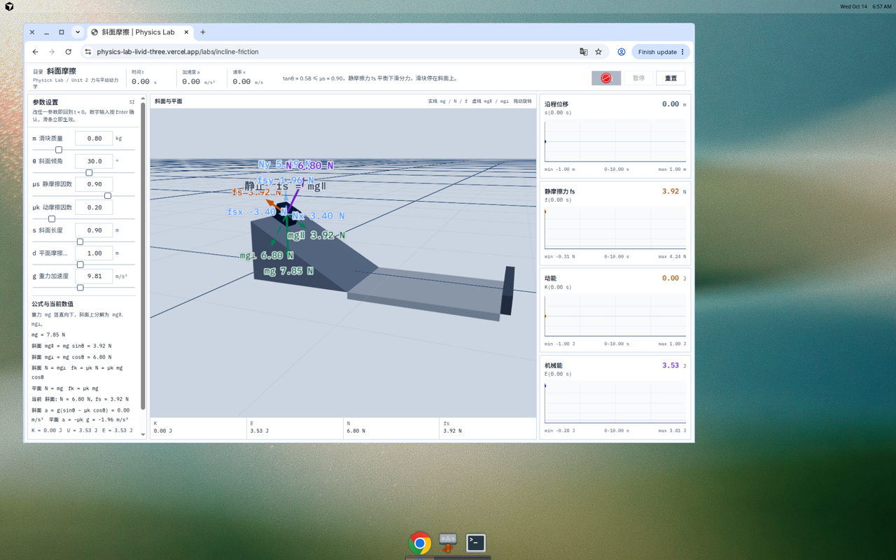
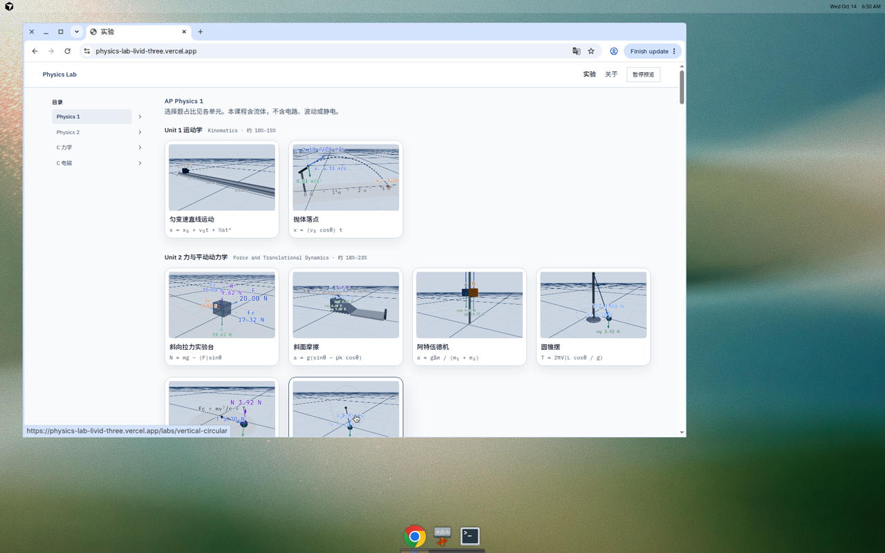
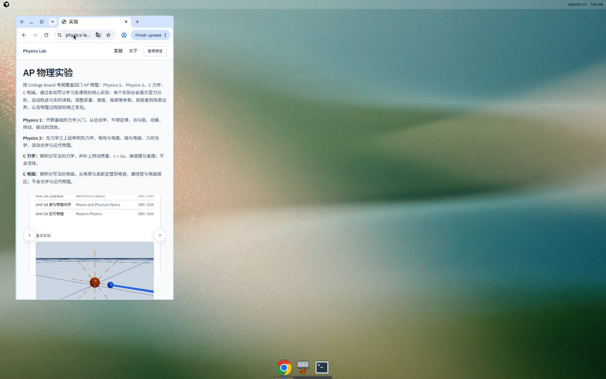
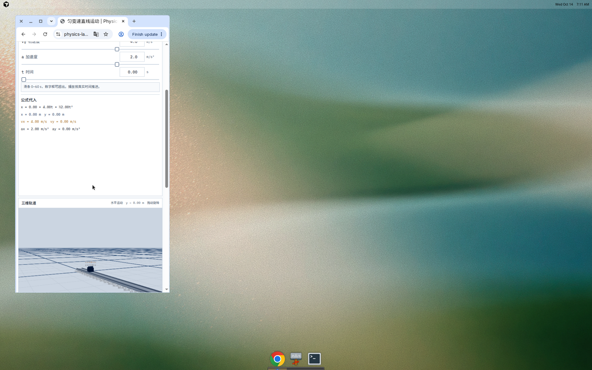

# Bruce · Physics Lab 作品检查

> 2026-10-14 对照线上站点与仓库 `main`（最后提交 2026-09-18）。截图在同目录 `assets/physics-lab-review-2026-10-14/`。同一份表也有 Numbers 文件：`Bruce-Physics-Lab-作品检查.numbers`。

- 学生：Bruce
- 项目：力学模型可视化 / Physics Lab
- 网站：https://physics-lab-livid-three.vercel.app/
- 仓库：https://github.com/Bruceeeg/Physics-Lab
- 计划课时：16 小时
- 已上课时：14 小时
- 剩余：2 小时，尚未重新预约

## 问题

| 编号 | 问题 | 截图 | 改进建议 | 进度 |
|------|------|------|----------|------|
| 1 | 竖直圆周在绳子已经不受拉时仍贴着圆走。R = 0.55 m、底端速率 4.80 m/s，低于过顶所需的 √(5gR) = 5.19 m/s。张力降到 −0.64 N，小球还在橙色圆周上。页头写「在圆弧上摆荡」，读数却是负张力。圆旁标着 2.19 m/s，底栏是 1.87 m/s。约 30 秒后右侧四张图挤成竖条。 | [01-vertical-circle.webp](./assets/physics-lab-review-2026-10-14/01-vertical-circle.webp) | 张力到 0 时改成抛体，圆只画到脱轨点。场景、页头、底栏共用一次采样。时间图只留最近两三个周期。 | 未改。9 月 11 日清单里的「脱离轨道」仍开着，建议下次课先改这项。 |
| 2 | 流体孔流的数字是对的，水箱和水柱看不见。液面 0.80 m、孔高 0.25 m 时，v = 3.28 m/s、射程 0.74 m、飞行 0.23 s，与 √(2gh)、R = 2√(h·y孔) 一致。画面只有发灰方盒、几个黑点和速度字。首页预览是同一幅空场景。 | [02-fluid-lab.webp](./assets/physics-lab-review-2026-10-14/02-fluid-lab.webp)、[02-fluid-home.webp](./assets/physics-lab-review-2026-10-14/02-fluid-home.webp) | 画出水位、孔和抛物水舌，射程标在落点上。首页预览用这个场景。 | 未改。公式可保留，补画面即可。 |
| 3 | 受力数字叠在物体上。斜面在 θ = 30°、μs = 0.90 时判断正确（加速度 0，静摩擦 3.92 N，滑块停住），但 fs、N、mg 压在滑块上。目录「斜向拉力」卡片把多组牛顿数叠在一个小方块上。圆锥摆、阿特伍德机的张力也贴在物体上。 | [03-incline-labels.webp](./assets/physics-lab-review-2026-10-14/03-incline-labels.webp)、[03-catalog-labels.webp](./assets/physics-lab-review-2026-10-14/03-catalog-labels.webp) | 每个力用短引线拉到物体外面。卡片缩略图只留运动，不写全部力的数字。 | 未改。计算不用动，改标注。 |
| 4 | 窗口收到约 400 像素宽时，首页考纲表的中文单元名和英文名叠在一起。匀变速直线的三维轨道要再往下滚，露出来只有一条很矮的画布。 | [04-narrow-syllabus.webp](./assets/physics-lab-review-2026-10-14/04-narrow-syllabus.webp)、[04-narrow-canvas.webp](./assets/physics-lab-review-2026-10-14/04-narrow-canvas.webp) | 窄屏改成一个单元一块。实验台把三维放在参数上面，并给画布一个最小高度。 | 未改。手机上看作品集时会先碰到。 |
| 5 | 时间图纵轴把 0 硬包进来，恒定加速度贴在图的上沿，下面空出负值。匀变速直线播到五十多秒时，时间框、轨道速度和右侧图不是同一个时刻，速度能差出大约 1 m/s。 | 与问题 1 的时间图是同一类现象，见 [01-vertical-circle.webp](./assets/physics-lab-review-2026-10-14/01-vertical-circle.webp) | 纵轴按这条曲线自己的最小最大值来定。场景、图和底栏共用一次计算结果。长过程要抽稀。 | 未改。坐标写在 `components/kinematic-charts.tsx` 的 `axisRange`。 |

## 截图

### 1. 竖直圆周

### 2. 流体孔流

### 3. 受力标注

### 4. 窄屏

## 已核对、公式与画面一致

| 实验 | 核对 | 结果 |
|------|------|------|
| 抛体落点 | 5.0 m/s、45°、高度 1.00 m | 射程 3.32 m，最高 1.64 m，机械能 4.46 J 保持不变 |
| 斜面摩擦 | θ = 30°、μs = 0.90、μk = 0.20 | 加速度 0，静摩擦等于重力沿斜面分力 3.92 N，滑块停住 |
| 圆锥摆 | 摆长 1.20 m、张角 25°、切向速度 1.52 m/s | 张力 4.33 N，水平分力 1.83 N，与 mv²/r 相同 |
| 阿特伍德机 | 1.00 kg 对 1.20 kg；以及质量差很大时 | 加速度 0.89 m/s²、张力 10.70 N；位移停在行程 0.55 m。A/B 有颜色 |
| 薄透镜 | f = 20 cm、物距 50 cm | 像距 33.33 cm、放大率 −0.67。光路本身仍像一团灰影 |
| 流体孔流数字 | 见问题 2 | 出流速度、射程、飞行时间与托里拆利公式一致 |

圆锥摆还有一个边界：张角由滑条直接给定，张力用 mg/cosθ。默认速度刚好是这个张角的平衡速度。把切向速度改离 1.52 m/s 后，画面仍停在 25°，向心力不再平衡。

## 进度

| 项 | 现状 |
|----|------|
| 课时 | 14 / 16 小时（88%）。6 次课已上完，剩余 2 小时。9 月 25 日因 SAT 备考取消后没有再约 |
| 目录 | 40 个实验都可进入，没有「等待开发」 |
| 仓库 | 停在 2026-09-18。那次把首页收成四门课的考纲概览 |
| 9 月 11 日清单里已经上线的 | 首页宽屏四列；阿特伍德机 A/B 与颜色；行程到上限会停下；抛体能量；圆周拆成圆锥摆、水平圆周、竖直圆周三个页面 |
| 仍开着的 | 竖直圆周脱轨；孔流和受力图的画面；窄屏；时间图坐标。结课论文仍是草稿，没有演示视频 |
